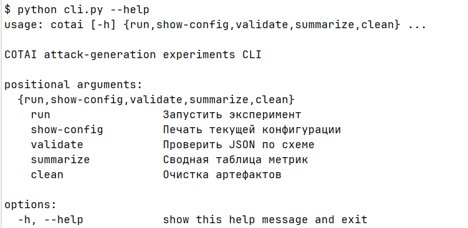
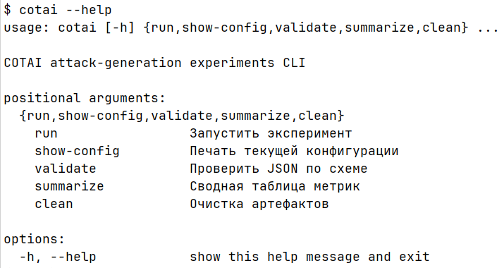

# COTAIAttackGeneration

## Требования
- Python версии 3.11
- примерно 1.6 Гб свободного места(зависимости в проекте занимают 1.55 Гб)

Работа выполнялась на операционной системе Windows 11.

## 1. Цель
Оценка устойчивости модели MLP-классификатор к атаке FGSM
на датасете NSL-KDD и формирование воспроизводимых
записей измерений в формате COTAI.

## 2. Среда и воспроизводимость
- Python: 3.11
- Библиотеки:
  - tensorflow 2.13.00
  - adversarial-robustness-toolbox 1.17.00 
  - scikit-learn 1.1.3
  - numpy 1.23.5
  - pandas 2.0.3
- Датасет: NSL-KDD
- Модель: MLP-классификатор
- Стадия ЖЦ: testing
- Предметная область: Обнаружение вторжения в сеть
- Random seeds: 42, 43, 44

## 3. Подготовка данных
- Обучающая выборка: 125 972 объекта
- Тестовая выборка: 22 543 объекта

## 4. Модель
- Архитектура: Dense(64,relu) → Dense(32,relu) → Dense(2,softmax)
- Loss: SparseCategoricalCrossentropy
- Optimizer: Adam
- Эпох: 15, batch size: 256

## 5. Настройка проекта

### Базовая настройка проекта

1. Создайте виртуальное окружение при помощи pip: `python -m venv venv`
2. Активируйте виртуальное окружение:
   - `source .venv/Scripts/activate` для Windows
   - `source .venv/bin/Activate` для Linux/macOS
3. Обновить pip: `python.exe -m pip install --upgrade pip`
4. Установите зависимости из файла `requirements.txt`: `pip install -r requirements.txt`

Проверьте работу программы при помощи следующей команды: `python cli.py run --seeds 42 43 44 --eps 0.1`

Скриншот работы команды `python cli.py --help`:

### Установка пакета (опциально)

Для того, чтобы использовать CLI-инструмент напрямую необходимо установить проект как пакет при помощи следующей команды:
1. `python -m pip install -e .` - команда установки проекта как пакета

Скриншот работы команды `cotai --help`:

## 6. Описание CLI-инструмента

### Список и описание доступных команд
| Название команды | Описание команды                                    |
| ---------------- | --------------------------------------------------- |
| `run`            | осуществляет запуск эксперимента                    |
| `validate`       | осуществляет проверку JSON по схеме                 |
| `summarize`      | выводит сводную таблицу метрик для указанного файла |
| `clean`          | производит очистку артефактов                       |

### Описание аргументов команды run
| Имя аргумента      | Описание аргумента                                         | Тип       | Обратный аргумент     | Значение по умолчанию                  |
| ------------------ | ---------------------------------------------------------- | --------- | --------------------- | -------------------------------------- |
| `--seeds`          | список seed'ов                                             | `int`     | -                     | `[42, 43, 44]`                         |
| `--eps`            | параметр эпсилон для FGSM                                  | `float`   | -                     | `0.1`                                  |
| `--epochs`         | количество эпох обучения                                   | `int`     | -                     | `15`                                   |
| `--batch-size`     | размер батча                                               | `int`     | -                     | `256`                                  |
| `--retrain`        | переобучать модель на каждом seed                          | `boolean` | `--no-retrain`        | `True`                                 |
| `--project-onehot` | схлопывать one-hot обратно после FGSM                      | `boolean` | `--no-project-onehot` | `True`                                 |
| `--round-binary`   | округлять бинарные признаки до {0,1}                       | `boolean` | `--no-round-binary`   | `True`                                 |
| `--predictions`    | сохранять y_before/y_after/X_adv в .npy                    | `boolean` | `--no-predictions`    | `True`                                 |
| `--training-logs`  | сохранять CSV/TXT-логи обучения                            | `boolean` | `--no-training-logs`  | `True`                                 |
| `--output`         | задает путь к JSON с результатами                          | `string`  | -                     | `results/results_{experiment_id}.json` |
| `--data-dir`       | задает каталог с файлами NSL-KDD                           | `string`  | -                     | `datasets/`                            |
| `--experiment_id`  | переопределяет experiment_id                               | `string`  | -                     | `exp_nslkdd_mlp_fgsm_v1`               |
| `--dry-run`        | показывает конфигурацию эксперимента и выходит без запуска | -         | -                     | -                                      |

### Описание аргументов команды validate
| Имя аргумента | Описание аргумента       | Тип      | Обратный аргумент | Значение по умолчанию               |
| ------------- | ------------------------ | -------- | ----------------- | ----------------------------------- |
| `--results`   | путь к проверяемому JSON | `string` | -                 | `results/`                          |
| `--schema`    | путь к JSON-схеме        | `string` | -                 | `schema/cotai_evidence.schema.json` |

### Описание аргументов команды summarize
| Имя аргумента | Описание аргумента | Тип      | Обратный аргумент | Значение по умолчанию |
| ------------- | ------------------ | -------- | ----------------- | --------------------- |
| `--results`   | путь к JSON файлу  | `string` | -                 | `results/`            |

### Описание аргументов команды clean
| Имя аргумента | Описание аргумента                                 | Тип       | Обратный аргумент | Значение по умолчанию |
| ------------- | -------------------------------------------------- | --------- | ----------------- | --------------------- |
| `--logs`      | удаляет содержимое папки logs/                     | `boolean` | -                 | `True`                |
| `--results`   | удаляет содержимое папки results/                  | `boolean` | -                 | `True`                |
| `--models`    | удаляет содержимое папки models/                   | `boolean` | -                 | `True`                |
| `--all`       | удаляет содержимое папок logs/, results/ и models/ | `boolean` | -                 | `True`                |
| `--yes`       | удаляет указанные папки без подтверждения          | `boolean` | -                 | `True`                |
